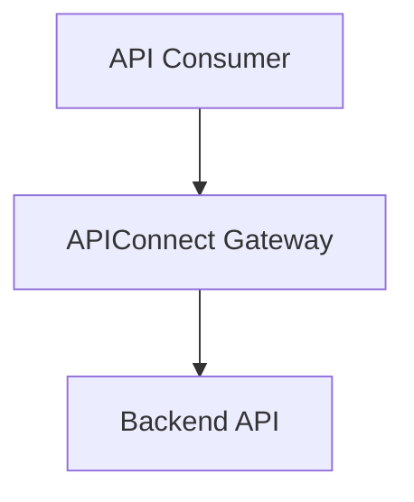

# APIConnect Documentation

A documentation website for **APIConnect**, a fictional API management
platform. The project is built with [Docusaurus](https://docusaurus.io/)
and follows a Docs-as-Code approach: documentation is written in
Markdown, maintained in Git, and previewed locally before publishing.

> **Project purpose:** This is a learning and portfolio project.
> APIConnect, its features, endpoints, examples, and product behaviour
> are illustrative and do not describe a real service.

## About APIConnect

APIConnect represents a centralized API management platform that helps
teams:

-   Register and manage APIs through a central catalog.
-   Generate access tokens and manage API permissions.
-   Consume APIs using authenticated HTTP requests.
-   Understand API architecture and request flows.
-   Review product updates and known limitations.

## Documentation

  -----------------------------------------------------------------------
  Section                             Contents
  ----------------------------------- -----------------------------------
  Welcome                             Product overview and links to key
                                      documentation

  Getting started                     Introduction, platform
                                      architecture, and Quick Start

  User Guides                         Register an API, create an API
                                      token, and make an API request

  Release Notes                       APIConnect 1.0 release information
  -----------------------------------------------------------------------

## Built with

-   **Docusaurus 3** -- documentation website framework
-   **React** -- homepage components
-   **Markdown / MDX** -- documentation content
-   **Mermaid** -- architecture and flow diagrams
-   **CSS Modules** -- homepage styling
-   **Git and GitHub** -- source control and collaboration
-   **Node.js and npm** -- local development and builds

## Prerequisites

Install the following before working on the project:

-   [Node.js](https://nodejs.org/) (use a version supported by your
    installed Docusaurus release)
-   npm (included with Node.js)
-   [Git](https://git-scm.com/)
-   [Visual Studio Code](https://code.visualstudio.com/) or another code
    editor

## Run the website locally

1.  Clone the repository:

    ``` bash
    git clone <repository-url>
    ```

2.  Change to the project directory:

    ``` bash
    cd docs-as-code-starter
    ```

3.  Install dependencies:

    ``` bash
    npm install
    ```

4.  Start the local development server:

    ``` bash
    npm start
    ```

5.  Open the local URL shown in the terminal (normally
    `http://localhost:3000`).

The development server refreshes the site when you save documentation or
code changes.

### Stop the development server

In the terminal running Docusaurus, press `Ctrl + C`.

If port 3000 is already in use, stop the existing development server or
accept Docusaurus' prompt to use another port.

## Useful commands

  -----------------------------------------------------------------------
  Command                             Description
  ----------------------------------- -----------------------------------
  `npm install`                       Install project dependencies

  `npm start`                         Start the local development server

  `npm run build`                     Generate the production website in
                                      the `build/` directory

  `npm run serve`                     Serve the production build locally

  `npm run clear`                     Clear Docusaurus' generated cache
  -----------------------------------------------------------------------

Run these commands from the project root.

## Project structure

The main project files are organized as follows. Some configuration and
support files may differ depending on the current repository setup.

``` text
.
├── docs/
│   ├── intro.md
│   ├── getting-started/
│   │   ├── intro.md
│   │   ├── architecture.md
│   │   └── quick-start.md
│   ├── user-guides/
│   │   ├── register-api.md
│   │   ├── create-api-token.md
│   │   └── make-api-request.md
│   └── release-notes/
│       └── version-1.0.md
├── src/
│   ├── clientModules/
│   │   └── d3-transition.js
│   ├── css/
│   │   └── custom.css
│   └── pages/
│       ├── index.js
│       └── index.module.css
├── static/
│   └── img/
├── docusaurus.config.js
├── sidebars.js
├── package.json
└── README.md
```

## Add or update documentation

1.  Open the relevant Markdown file under `docs/`.

2.  Write or update the content using Markdown.

3.  Add or update front matter when a custom title, sidebar label,
    position, or document ID is needed.

4.  Use relative links to connect related documentation pages.

5.  Add images under `static/img/` and reference them with paths such
    as:

    ``` markdown
    
    ```

6.  Preview the page with `npm start`.

7.  Run `npm run build` to check the production build before committing.

### Mermaid diagrams

Mermaid is enabled through the Docusaurus Mermaid theme and the
`markdown.mermaid` configuration. A diagram can be added to a Markdown
page using a fenced `mermaid` block:

```` markdown

````

The project also includes a D3 transition client module registered in
`docusaurus.config.js`. Keep this support file in place unless the
Mermaid integration is deliberately changed and tested.

## Contribution workflow

A simple Docs-as-Code workflow for this project:

1.  Create a branch for your change.
2.  Edit the Markdown, React, or CSS files.
3.  Preview the changes locally.
4.  Run `npm run build` and resolve build errors.
5.  Commit the changes with a clear message.
6.  Push the branch and open a pull request.
7.  Review the changes before merging.

Example Git commands:

``` bash
git checkout -b docs/update-quick-start
git status
git add .
git commit -m "Update Quick Start documentation"
git push -u origin docs/update-quick-start
```

## Deployment

The `build/` directory contains the generated static website after
running:

``` bash
npm run build
```

Publish the contents of that directory using the hosting and CI/CD
process approved for your repository. GitHub Pages or GitHub Actions
deployment is not assumed; availability depends on repository and
organization settings.

Before deployment, verify the configured `url`, `baseUrl`, repository
details, and deployment target in `docusaurus.config.js`.

## Notes and limitations

-   APIConnect is fictional and is intended for documentation practice.
-   Example API URLs, tokens, customer data, and responses are
    placeholders.
-   Do not use real credentials or secrets in documentation or source
    control.
-   Do not run `npm audit fix --force` without reviewing the proposed
    dependency changes, as it may introduce breaking updates.
-   Review dependency audit findings and keep project dependencies
    maintained.

## Learning objectives

This project is intended to practise:

-   Structuring product documentation and information architecture.
-   Writing task-based user guides and release notes.
-   Creating architecture diagrams with Mermaid.
-   Using Markdown, MDX, React, and CSS in Docusaurus.
-   Managing documentation changes through Git.
-   Building and validating a static documentation website.

------------------------------------------------------------------------

**APIConnect Documentation** · Built with Docusaurus.
