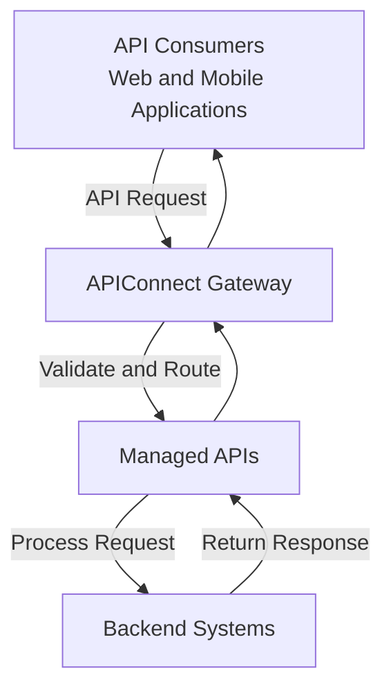

# APIConnect Architecture

## Overview

APIConnect is a centralized API management platform that enables organizations to register, secure, publish and monitor APIs.

The platform acts as an intermediary between API consumers and backend services. It manages incoming API requests, validates access credentials and routes requests to the appropriate API services.

## High-level architecture

The following diagram illustrates the main components of the APIConnect platform.

## Architecture components

The APIConnect platform consists of the following logical components.

### 1. API Consumers

API consumers are applications or developers that access APIs published through APIConnect.

Examples include:

- Web applications.
- Mobile applications.
- Third-party integrations.

### 2. APIConnect Gateway

The APIConnect Gateway acts as the entry point for incoming API requests.

Its responsibilities include:

- Receiving API requests.
- Validating access tokens.
- Enforcing access permissions.
- Routing requests to the appropriate API.

### 3. Managed APIs

Managed APIs are registered and configured in the APIConnect platform.

Examples include:

| API | Description |
|---|---|
| Customer Profile API | Retrieves customer information |
| Order Management API | Retrieves and manages order information |

### 4. Backend Systems

Backend systems process requests received through the managed APIs.

Examples include:

- Customer databases.
- Order management services.
- Enterprise business applications.

## API request flow

The following steps describe how an API request is processed.

1. An API consumer sends an HTTP request to an APIConnect endpoint.
2. The APIConnect Gateway receives the request.
3. The gateway validates the access token and checks the required permissions.
4. The request is routed to the appropriate managed API.
5. The backend system processes the request.
6. The API response is returned to the consumer through the gateway.

## Security considerations

APIConnect uses access tokens to authenticate API consumers.

Follow these security practices:

- Use valid access tokens for API requests.
- Assign only the permissions required by an application.
- Store access tokens securely.
- Revoke tokens that are no longer required.
- Avoid exposing credentials in source code or public repositories.

:::important
The APIConnect Gateway must validate access credentials before forwarding protected API requests to backend services.
:::

## Related information

- [Register an API](../user-guides/register-api.md)
- [Create an API Token](../user-guides/create-api-token.md)
- [Make an API Request](../user-guides/make-api-request.md)
